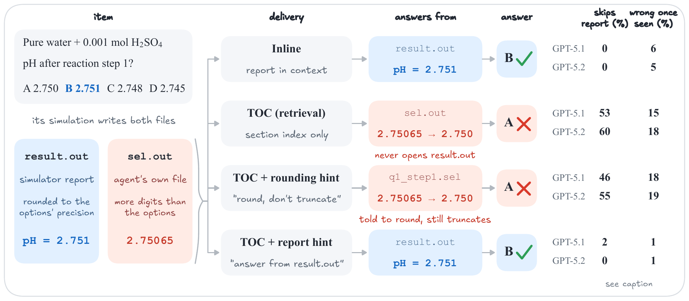

# Same Simulation, Different Evidence

Code, data, and run outputs for **Same Simulation, Different Evidence: Where Retrieved Tool Output Costs LLM Agents Accuracy** ([arXiv:2610.26836](https://arxiv.org/abs/2610.26836)). The verified items and per-item predictions are also on Hugging Face: [grenadeComing/same-simulation-different-evidence](https://huggingface.co/datasets/grenadeComing/same-simulation-different-evidence).

An agent harness can paste a long tool output into the context (inline) or save it to a file that the agent reads on demand (retrieval). We study where retrieval costs accuracy with PHREEQC, a deterministic geochemistry simulator, on 158 execution-verified multiple-choice items:

- **The cost depends on the model.** Reading the simulator's report through a section index (TOC) instead of inline costs GPT-5.1 and GPT-5.2 11.3 and 7.9 points of accuracy; Claude Opus 4.6, Claude Sonnet 4.6, and GPT-5.4 show no detectable net change.
- **The loss is in what agents read, not in what they compute.** Re-running all 11,007 logged simulator calls shows that the GPT models compute the keyed value about as often under either interface. Under retrieval they answer from their own higher-precision output files and misround to a neighboring option (evidence substitution).
- **Naming the authoritative output removes the loss.** An instruction to answer from the report raises accuracy by 6.3–7.9 points over plain retrieval for the three GPT models; an instruction to round correctly does not.



The items are the four-option multiple-choice items of [PHREEQC-MCQ-200](https://arxiv.org/abs/2607.00436); this repository includes the full 200-item pool and the 158 items retained after answer-key verification.

## Contents

| Path | What it holds |
|---|---|
| `datasets/dataset_200_clean.jsonl` | The 200-item pool of four-option PHREEQC items |
| `datasets/dataset_158_verified.jsonl` | The 158 items retained after answer-key verification (all main-text results) |
| `phreeqc.dat`, `database_reference.txt` | The frozen PHREEQC database and the reference file placed in every agent workspace |
| `agent/configs/system_prompt_MCQ.txt` | System prompt of the full agents (the `execute_phreeqc` line is replaced per condition in `scripts/evaluate_custom.py`) |
| `scripts/` | Agent harness (`evaluate_custom.py`), no-tool baselines (`oneshot.py`), paired replay (`prepare_frozen_replay.py`, `run_frozen_replay.py`, `FROZEN_REPLAY.md`), shared helpers (`_common.py`) |
| `result/custom/`, `result/oneshot/` | Every run with logs that the paper uses (see the run map below) |

Each run directory holds `results.jsonl` (per-item prediction and correctness), `summary.json` (model, condition, settings, token totals), and `work_space/dataset_q_XXXXX/` for every item. Each item folder contains the agent's input files, the files its simulations wrote, its final answer, and `logs/chat_*.jsonl`. These logs record every model call and every tool result. `dataset_q_XXXXX` is the item's 1-based index in the 200-item pool.

## Run map

Model tags: `opus46` = Claude Opus 4.6, `sonnet46` = Claude Sonnet 4.6, `gpt_5_4_`/`gpt54` = GPT-5.4, `gpt52` = GPT-5.2, `gpt51` = GPT-5.1, `gflash3` = Gemini 3 Flash Preview. Condition names in `summary.json`:
- `full` = Raw100k
- `toc` = TOC
- `grep` = Grep
- `hybrid` = Hybrid
- `toc_report` = TOC+Report
- `toc_round` = TOC+Round

| Directory | Runs |
|---|---|
| `result/custom/pool200_clean_rerun_*_toc_<model>` | TOC reruns, three per model (Sonnet, GPT-5.4, GPT-5.2, GPT-5.1) |
| `result/custom/pool200_tocfix_uncapped_capaffected45_toc_<model>` | TOC on the 33 verified long-output items (45 in the pool) with the index built for every report size; these results replace the reruns' results on those items |
| `result/custom/pool200_grep_<model>` | Grep (Sonnet, GPT-5.2, GPT-5.1) |
| `result/custom/raw100k_repeat_<model>` | Logged Raw100k runs of GPT-5.1 and GPT-5.2 |
| `result/custom/report158_verified/` | TOC control (`*_toc_run1`), TOC+Report (`*_tocreport_run*`), TOC+Round (`*_tocround_run*`), and GPT-5.4's logged Raw100k run (`gpt54_raw100k_run1`) |
| `result/custom/hybrid158_verified/` | Hybrid, three runs each for GPT-5.2 and GPT-5.1 |
| `result/custom/frozen_replay_gpt52/` | Paired replay: checkpoints with frozen reports, both arms, three repeats |
| `result/custom/pool200_clean_agent100k_{toc,raw100k}_gflash3` | Gemini 3 Flash headline runs |
| `result/oneshot/pool200_clean_{oneshot,cot}_<model>` | Direct and CoT baselines |

## Running the agents

Requirements: Python 3.10+ and PHREEQC 3.8.6. To run an agent condition (API keys via `OPENAI_API_KEY`, `ANTHROPIC_API_KEY`, or `GOOGLE_API_KEY`):

```bash
pip install -r requirements.txt
PHREEQC_BIN=/path/to/phreeqc python3 scripts/evaluate_custom.py \
  --dataset datasets/dataset_158_verified.jsonl --model gpt-5.2 --context-mode toc --name my_toc_run
```

## Notes

- Simulator reports (`result.out`) written during agent runs are omitted to save space. They are deterministic: re-running the agent's input with PHREEQC 3.8.6 and `phreeqc.dat` reproduces them. The frozen reports of the paired replay are included.
- Absolute paths in logs and records were rewritten to `/workspace/...` and some run directories were renamed. File contents are otherwise unchanged.

## Citation

```bibtex
@article{zhang2026samesimulation,
  title   = {Same Simulation, Different Evidence: Where Retrieved Tool Output Costs {LLM} Agents Accuracy},
  author  = {Zhang, Ke and Chundur, Sahchit and Owusu, Jerry Peprah and Abdolhosseini Qomi, Mohammad Javad and Raissi, Maziar},
  journal = {arXiv preprint arXiv:2610.26836},
  year    = {2026}
}
```

If you use the items, please also cite PHREEQC-MCQ-200:

```bibtex
@article{zhang2026phreeqcmcq,
  title   = {{PHREEQC-MCQ-200}: A Diagnostic Benchmark for Tool-Augmented Scientific Simulator Agents},
  author  = {Zhang, Ke and Chundur, Sahchit and Abdolhosseini Qomi, Mohammad Javad and Raissi, Maziar},
  journal = {arXiv preprint arXiv:2607.00436},
  year    = {2026}
}
```

## License

The code is released under the MIT License (`LICENSE`). The items and model outputs are covered by `DATA_LICENSE.md`.
